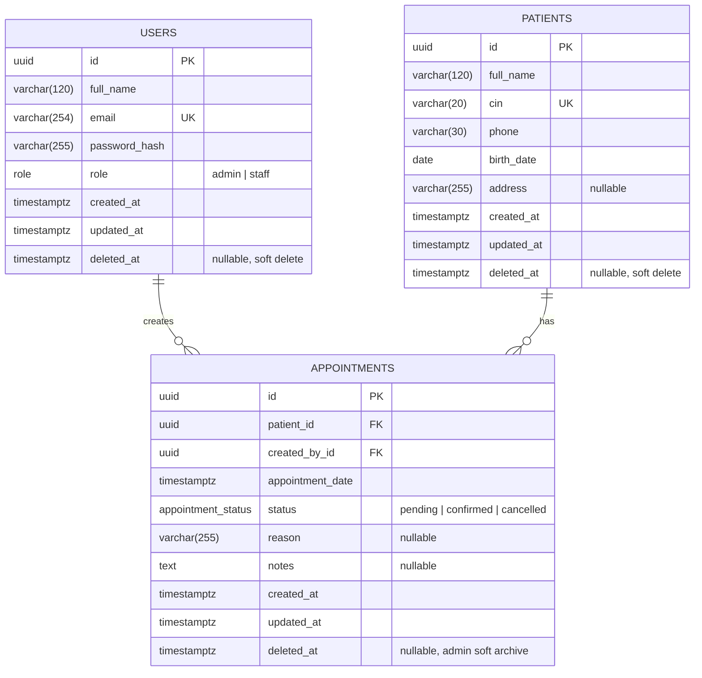

# ClinicFlow — Database Design

> This document is the source of truth for the relational model. It was written
> before the API and UI were implemented. The Prisma schema and committed SQL
> migration implement exactly this design.

## 1. Design goals

- Preserve clinical and scheduling history. **No application operation hard-deletes
  patients, users, or appointments.** Removals are soft: users/patients are
  deactivated and appointments are archived by an admin.
- Keep identity fields (`email`, `cin`) canonical and unique.
- Make the database the last line of defence for allowed roles/statuses, foreign
  keys, uniqueness, and timestamp integrity.
- Support the two dominant read paths efficiently:
  - case-insensitive patient search by name or CIN;
  - appointment filtering by clinic day and status.
- Store every instant in UTC (`timestamptz`) and interpret clinic days in the
  configured clinic timezone.

## 2. Entity Relationship Diagram



### Cardinalities

| Relationship | Cardinality | Rule |
| --- | --- | --- |
| `patients` → `appointments` | 1 : 0..N | An appointment belongs to exactly one patient. A patient can have many appointments. |
| `users` → `appointments` | 1 : 0..N | Every appointment records exactly one creator. A user can create many appointments. |
| `appointments.patient_id` | mandatory FK | `ON DELETE RESTRICT`, `ON UPDATE CASCADE`. |
| `appointments.created_by_id` | mandatory FK | `ON DELETE RESTRICT`, `ON UPDATE CASCADE`. |

## 3. Enumerated types

PostgreSQL enums are used so invalid values cannot be stored even if a client
bypasses the API.

```sql
CREATE TYPE "role" AS ENUM ('admin', 'staff');
CREATE TYPE "appointment_status" AS ENUM ('pending', 'confirmed', 'cancelled');
```

## 4. Tables

### 4.1 `users`

| Column | Type | Null | Default | Notes |
| --- | --- | --- | --- | --- |
| `id` | `uuid` | no | `gen_random_uuid()` | Primary key. |
| `full_name` | `varchar(120)` | no | — | Trimmed, non-empty. |
| `email` | `varchar(254)` | no | — | Stored lowercase; unique. |
| `password_hash` | `varchar(255)` | no | — | bcrypt hash (cost 12). Never selected into API DTOs. |
| `role` | `role` | no | `staff` | `admin` or `staff`. |
| `created_at` | `timestamptz(3)` | no | `now()` | UTC instant. |
| `updated_at` | `timestamptz(3)` | no | `now()` | Maintained by Prisma on update. |
| `deleted_at` | `timestamptz(3)` | yes | `null` | Soft-deactivation. Non-null users cannot authenticate. |

**Constraints**

- `users_pkey` on `id`.
- `users_email_key` unique on `email`.
- `users_email_lowercase_check`: `email = lower(email)`.
- `users_full_name_not_blank_check`: `length(btrim(full_name)) > 0`.

**Indexes**

- Unique index on `email` — login lookup and uniqueness.
- `users_role_idx` — admin user-management filtering.
- `users_deleted_at_idx` — active-user filtering.

### 4.2 `patients`

| Column | Type | Null | Default | Notes |
| --- | --- | --- | --- | --- |
| `id` | `uuid` | no | `gen_random_uuid()` | Primary key. |
| `full_name` | `varchar(120)` | no | — | Trimmed, non-empty. |
| `cin` | `varchar(20)` | no | — | Canonical uppercase CIN; unique. |
| `phone` | `varchar(30)` | no | — | Validated human-readable phone. |
| `birth_date` | `date` | no | — | Calendar date, no timezone. |
| `address` | `varchar(255)` | yes | `null` | Optional. |
| `created_at` | `timestamptz(3)` | no | `now()` | UTC instant. |
| `updated_at` | `timestamptz(3)` | no | `now()` | Maintained by Prisma. |
| `deleted_at` | `timestamptz(3)` | yes | `null` | Soft delete. |

**Constraints**

- `patients_pkey` on `id`.
- `patients_cin_key` unique on `cin`.
- `patients_cin_canonical_check`: `cin = upper(cin)` and `cin ~ '^[A-Z0-9]{5,20}$'`.
- `patients_full_name_not_blank_check`: `length(btrim(full_name)) > 0`.
- `patients_birth_date_not_future_check`: `birth_date <= CURRENT_DATE`.

**Indexes**

| Index | Type | Justification |
| --- | --- | --- |
| `patients_cin_key` | B-tree unique | Exact CIN lookup and duplicate prevention. |
| `patients_full_name_trgm_idx` | GIN `gin_trgm_ops` | Efficient `ILIKE '%term%'` partial-name search. |
| `patients_cin_trgm_idx` | GIN `gin_trgm_ops` | Efficient partial CIN search from the same search box. |
| `patients_full_name_idx` | B-tree | Deterministic sorting by name in list views. |
| `patients_created_at_idx` | B-tree | Default "newest first" list ordering. |
| `patients_deleted_at_idx` | B-tree | Active-record filtering. |

`pg_trgm` is chosen over a full-text `tsvector` because clinic staff search by
fragments of a person's name (for example `"fat"` for `"Fatima"`) and by CIN
fragments, not by natural-language documents. `ILIKE` with a trigram GIN index
handles both patterns and avoids maintaining a separate search vector. Queries
shorter than three characters still work (sequential scan) but the clinic's
search UI debounces and is expected to be used with meaningful fragments.

### 4.3 `appointments`

| Column | Type | Null | Default | Notes |
| --- | --- | --- | --- | --- |
| `id` | `uuid` | no | `gen_random_uuid()` | Primary key. |
| `patient_id` | `uuid` | no | — | FK → `patients.id`. |
| `created_by_id` | `uuid` | no | — | FK → `users.id`. |
| `appointment_date` | `timestamptz(3)` | no | — | UTC instant; displayed in clinic timezone. |
| `status` | `appointment_status` | no | `pending` | See status rules. |
| `reason` | `varchar(255)` | yes | `null` | Short reason for visit. |
| `notes` | `text` | yes | `null` | Internal notes; never exposed publicly. |
| `created_at` | `timestamptz(3)` | no | `now()` | UTC instant. |
| `updated_at` | `timestamptz(3)` | no | `now()` | Maintained by Prisma. |
| `deleted_at` | `timestamptz(3)` | yes | `null` | Admin soft archive. Non-null appointments are excluded from all reads while the row and audit trail remain. |

**Constraints**

- `appointments_pkey` on `id`.
- `appointments_patient_id_fkey` FK → `patients(id)` `ON DELETE RESTRICT ON UPDATE CASCADE`.
- `appointments_created_by_id_fkey` FK → `users(id)` `ON DELETE RESTRICT ON UPDATE CASCADE`.
- Enum constraint for `status`.
- `appointments_reason_length_check`: `char_length(reason) <= 255` (also enforced by the type).

**Indexes**

| Index | Type | Justification |
| --- | --- | --- |
| `appointments_appointment_date_idx` | B-tree | Date-range scans for a clinic day / upcoming list. |
| `appointments_status_idx` | B-tree | Dashboard status aggregates and status filters. |
| `appointments_appointment_date_status_idx` | B-tree composite | Dominant query: date range + status. |
| `appointments_patient_id_appointment_date_idx` | B-tree composite | Patient detail timeline and patient-scoped queries. |
| `appointments_created_by_id_idx` | B-tree | Creator joins / future auditing. |
| `appointments_deleted_at_idx` | B-tree | Active-record filtering. |

## 5. Deletion and update behaviour

| Entity | Application behaviour | Database behaviour | Rationale |
| --- | --- | --- | --- |
| User | `DELETE /api/users/:id` sets `deleted_at`, revokes future access. | `RESTRICT` from appointments. No hard delete. | Preserve who created historical appointments; deactivation is reversible only through controlled admin action. |
| Patient | `DELETE /api/patients/:id` (admin only) sets `deleted_at` and cancels future `pending`/`confirmed` appointments in the same transaction. | `RESTRICT` from appointments. No cascade. | A deleted patient must disappear from search and cannot receive new appointments, while appointment history remains intact and attributable. |
| Appointment | `DELETE /api/appointments/:id` (admin only) sets `deleted_at`, hiding the row from lists, dashboards, and patient timelines. Cancellation remains a separate status transition. | No hard delete. `deleted_at` retains the row and its FKs. | Remove erroneous or duplicate bookings from day-to-day views without losing scheduling history or the creator/patient audit trail. |

Additional rules:

- A soft-deleted patient is excluded from list/detail endpoints (detail returns
  `404`) and cannot be selected for a new appointment (API returns `422`).
- A soft-deleted (archived) appointment is excluded from appointment lists,
  detail lookups (`404`), dashboards, and patient timelines. It can no longer be
  updated or have its status changed.
- Active appointments can be updated (patient, date, reason, notes) only while
  `pending` or `confirmed`; cancelled appointments are immutable. Any new date
  must be in the future.
- A soft-deleted user cannot log in, and existing JWTs are rejected because the
  auth middleware reloads the user on every request.
- Unique `email`/`cin` values remain reserved after soft deletion. Reusing a CIN
  for a different person would corrupt history, so a new record must use the
  original one (or an administrator restores the record through a controlled
  migration).
- An admin cannot soft-delete or demote their own account, and the last active
  admin cannot be demoted/deleted.

## 6. Appointment status rules

```
pending ──► confirmed ──► cancelled
   │
   └────────────────────► cancelled
```

| From | To | Allowed |
| --- | --- | --- |
| `pending` | `confirmed` | Yes |
| `pending` | `cancelled` | Yes |
| `confirmed` | `cancelled` | Yes |
| `confirmed` | `pending` | No |
| `cancelled` | `pending` / `confirmed` | No |
| same → same | No-op rejected with `422` | No |

The transition is validated in the service layer and only the `status` field is
accepted by the status endpoint. Clients cannot mass-assign other appointment
fields through it.

## 7. Timestamp and timezone policy

- All instants (`created_at`, `updated_at`, `deleted_at`, `appointment_date`) are
  stored as `timestamptz` in UTC.
- `birth_date` is a calendar `date`, because a birthday has no instant/timezone.
- Clinic-day boundaries (dashboard "today", appointment date filter) are computed
  with the `CLINIC_TIMEZONE` setting (`Africa/Casablanca` by default) using
  `date-fns-tz`.
- The API accepts and returns ISO-8601 instants. The web client converts the
  `datetime-local` input from clinic-local time to UTC before submitting, and
  renders all appointment times in the clinic timezone.
- Database `now()` is the authoritative server clock for audit timestamps.

## 8. Data integrity and security

- UUID primary keys prevent enumeration and make identifiers safe to expose.
- PostgreSQL enums constrain `role` and `status`.
- CHECK constraints canonicalize/lowercase email and uppercase CIN, prevent blank
  names, and prevent future birth dates.
- All queries use Prisma's parameterized query builder (no string interpolation
  of user input).
- `password_hash` is excluded from every DTO/select. API responses are built from
  explicit public field selections.
- Notes are internal data: only authenticated admin/staff requests can read them;
  they are never included in public or unauthenticated responses.
- The database user in development is the owner. In production, run migrations
  with a privileged deploy user and the application with a least-privilege user
  (SELECT/INSERT/UPDATE on required tables, no DDL).
- PII should not be written to application logs. Request logging records method,
  path, status, duration, and request id only.
